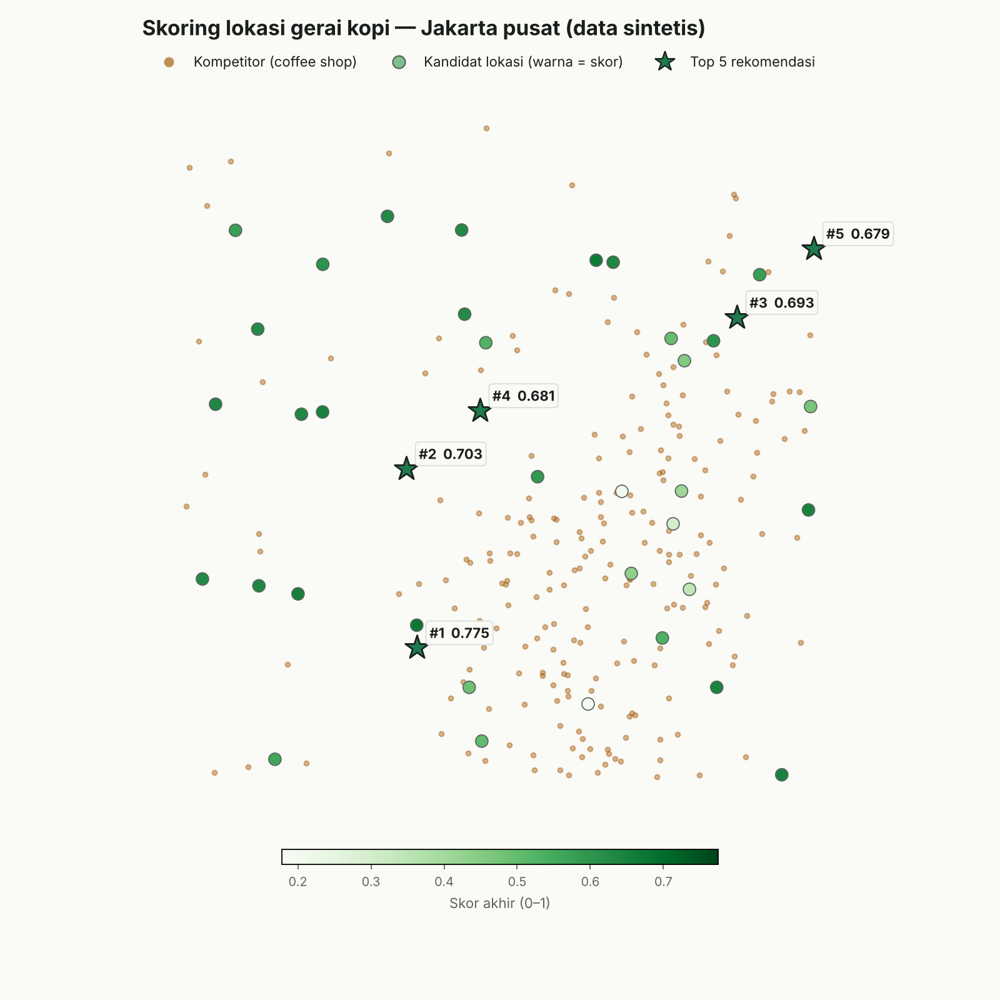

# Capstone: Cari Lokasi Gerai Kopi Terbaik di Jakarta

Proyek hands-on end-to-end yang menggabungkan teknik-teknik dari buku
**[Geospatial Data Science Essentials](https://www.janosov.com/) — Milan Janosov**
menjadi satu studi kasus nyata: *di antara beberapa kandidat lokasi sewa,
mana yang paling layak untuk membuka gerai kopi baru?*

Jawabannya dihitung dari dua sinyal spasial:

- **Tekanan kompetisi** — setiap coffee shop dalam radius 1 km ikut dihitung,
  dengan bobot menurun linear terhadap jarak (tetangga persis = 1.0,
  di 1 km = 0.0). Jumlah kompetitor dalam radius jalan kaki 400 m tetap
  dilaporkan sebagai `n_competitors` karena mudah dijelaskan ke bisnis.
- **Potensi foot traffic** — seberapa dekat lokasi itu dengan pusat
  keramaian/komersial kota

`final_score = 0.6 × competition_score + 0.4 × traffic_score`, keduanya
dinormalisasi 0–1 (bobot bisa diubah lewat `--competition-weight`).

> **Kenapa bukan sekadar "jumlah kompetitor dalam 400 m"?** Versi awal proyek
> ini memakai hitungan itu, dan 26 dari 40 kandidat sama-sama bernilai 0 —
> faktor kompetisi jadi tidak membedakan apa-apa dan ranking diam-diam hanya
> ditentukan foot traffic. Bobot jarak memecahkan masalah itu; ada test
> regresi (`test_ranking_is_not_degenerate`) supaya tidak terulang.

<p align="center">
  
</p>

## Pipeline & peta ke bab buku

| # | Langkah | Fungsi | Bab buku |
|---|---------|--------|----------|
| 1 | Kandidat lokasi (geocoding) | `src/generate_data.py` | Ch. 06 — Geocoding |
| 2 | Kompetitor dari OpenStreetMap | `src/generate_data.py` | Ch. 08 — OpenStreetMap |
| 3 | Reproject ke CRS lokal (meter) | `src/pipeline.py` | Ch. 04 — Map Projections |
| 4 | Buffer radius layanan | `src/pipeline.py` | Ch. 01 — Buffering a Geometry |
| 5 | Spatial join kandidat ⇄ kompetitor | `src/pipeline.py` | Ch. 02 — Spatial Join with GeoPandas |
| 6 | Fitur tekanan kompetisi (bobot jarak) & ranking | `src/pipeline.py` | Ch. 10 — Spatial Feature Generation |
| 7 | Peta statis & interaktif | `src/visualize.py` | Ch. 03 — Visualizing Geospatial Data |

## Cara menjalankan

```bash
python -m venv .venv && source .venv/bin/activate   # opsional tapi disarankan
pip install -r requirements.txt

python main.py                              # jalan dengan parameter default
python main.py --radius 600 --top 8         # radius jalan kaki 600 m, 8 rekomendasi
python main.py --max-radius 1500            # kompetitor sampai 1.5 km masih berpengaruh
python main.py --competition-weight 0.8     # kompetisi lebih dominan dari foot traffic
python main.py --regenerate                 # buat ulang data sintetis dari awal

pip install pytest && pytest -q             # 8 test: CRS/meter, sjoin vs brute-force, dst
```

Output tersimpan di `outputs/`:

- `scored_candidates.csv` — semua kandidat, terurut dari skor tertinggi
- `site_selection_map.png` — peta statis (Matplotlib)
- `interactive_map.html` — peta interaktif (Folium / `gdf.explore()`) — buka
  langsung di browser, bisa zoom/pan dan klik tiap titik untuk detail skornya

Contoh 5 besar dari satu run (`data/`, `outputs/` di-generate dengan seed
tetap jadi hasilnya reproducible):

| rank | name | n_competitors (≤400 m) | competition_pressure | nearest_competitor_m | final_score |
|------|------|-----|-------|------|-------|
| 1 | Ruko Jl. Kandidat No. 11 | 0 | 0.037 | 963 | 0.775 |
| 2 | Ruko Jl. Kandidat No. 22 | 0 | 0.074 | 926 | 0.703 |
| 3 | Ruko Jl. Kandidat No. 3  | 0 | 0.348 | 806 | 0.693 |
| 4 | Ruko Jl. Kandidat No. 27 | 0 | 0.180 | 820 | 0.681 |
| 5 | Ruko Jl. Kandidat No. 6  | 0 | 0.000 | ≥1000 | 0.679 |

Perhatikan: kandidat #1 hanya peringkat ke-9 dari sisi foot traffic, tapi
menang karena lingkungan 1 km-nya hampir kosong kompetitor — komponen
kompetisi sekarang benar-benar ikut menentukan hasil.

## Validasi

`tests/test_pipeline.py` (8 test, `pytest -q`) memastikan:

- buffer & jarak dihitung dalam **meter** (titik ~100 m terdeteksi, ~2 km tidak)
- hasil `gpd.sjoin` **identik** dengan perhitungan jarak brute-force
- bobot jarak sesuai rumus, kandidat tanpa kompetitor tidak error
- skor selalu 0–1 dan terurut; bobot yang tidak berjumlah 1 ditolak
- ranking tidak degenerate (regresi dari versi awal)
- data sintetis tidak menumpuk di tepi bounding box

## Tentang data sintetis vs. data OSM asli

Lingkungan tempat proyek ini pertama kali dibuat tidak punya akses internet
publik ke Nominatim / Overpass API, jadi `src/generate_data.py` membangun
dataset **sintetis tapi realistis**: kompetitor dikelompokkan di sekitar
area bisnis nyata Jakarta (SCBD, Senayan, Menteng, Kuningan, Kemang) alih-alih
tersebar acak murni.

Untuk beralih ke data asli, ganti isi `generate_candidates()` dan
`generate_competitors()` di `src/generate_data.py` dengan:

```python
from geopy.geocoders import Nominatim
from geopy.extra.rate_limiter import RateLimiter
import osmnx as ox

geocode = RateLimiter(Nominatim(user_agent="coffee-site-selection").geocode, min_delay_seconds=1)
# ... geocode daftar alamat kandidat Anda sendiri menjadi GeoDataFrame

competitors = ox.features_from_place(
    "Jakarta, Indonesia", tags={"shop": "coffee"}
)
```

**Tidak ada kode lain yang perlu diubah** — `pipeline.py` dan `visualize.py`
hanya bergantung pada bentuk data (`GeoDataFrame` dengan kolom `id` +
`geometry`), bukan dari mana datanya berasal.

## Struktur proyek

```
coffee-site-selection/
├── main.py                 # entry point CLI
├── requirements.txt
├── src/
│   ├── generate_data.py    # Ch. 06 & 08 — data kandidat + kompetitor
│   ├── pipeline.py         # Ch. 01, 02, 04, 10 — analisis spasial inti
│   └── visualize.py        # Ch. 03 — peta statis & interaktif
├── tests/
│   └── test_pipeline.py    # 8 test pytest
├── data/                   # di-generate otomatis (candidates/competitors.geojson)
└── outputs/                # di-generate otomatis (csv, png, html)
```

## Ide pengembangan lanjutan

- Ganti radius tunggal dengan **isochrone jalan kaki asli** (Ch. 09, `osmnx` + `networkx.ego_graph`) alih-alih buffer lingkaran
- Tambahkan lapisan **kepadatan penduduk** (raster, Ch. 07) sebagai sinyal ketiga
- Gunakan **H3 grid** (Ch. 05) untuk agregasi skala kota, bukan per-titik kandidat
- Jalankan **hotspot analysis / Getis-Ord Gi\*** (Ch. 10) pada kompetitor untuk mengidentifikasi klaster yang harus dihindari secara statistik, bukan cuma radius tetap

---

Dibuat sebagai pendamping hands-on dari ringkasan slide
*"Geospatial Data Science Essentials"* oleh Milan Janosov.
